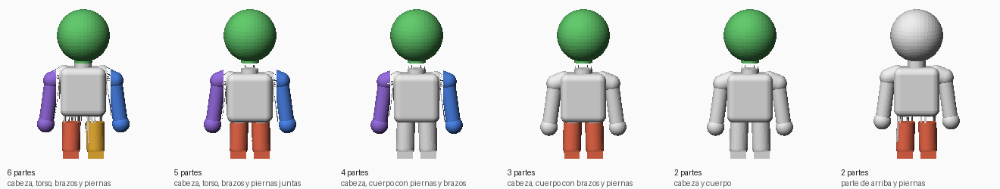

# 3DIA: imagen a 3D

Convierte una imagen (por ejemplo, la foto de una figura) en un modelo 3D `.glb`
con forma y color (textura), usando el modelo abierto [Hunyuan3D-2](https://github.com/Tencent-Hunyuan/Hunyuan3D-2).

Incluye:

- `generar3d.py`: línea de comandos, imagen -> modelo 3D.
- `app.py`: app web para subir la imagen, ver el modelo y descargarlo.
- `textura.py`: pinta la malla con Hunyuan3D-Paint (turbo).
- `relleno_uv.py`: relleno rápido de los huecos de la textura.
- `rasterizador.py`: rasterizador en PyTorch (sustituye al módulo CUDA compilado).
- `modelos.py`: descarga de pesos con reintentos.
- `preparar_imagen.py`: analiza la imagen y quita el fondo antes de generar.
- `acabados.py`: relieves de superficie para impresión 3D (tejido, moleteado...).
- `multicolor.py`: 3MF pintado por filamentos para impresoras multicolor.
- `dividir.py`: divide un modelo ya generado en partes (personaje o cortes planos).
- `personaje.py`: detecta cuello, hombros y entrepierna y separa cabeza, torso, brazos y piernas.
- `formas.py`: división automática de cualquier forma (patas, cola, cuello...).
- `segmentar.py`: cortes planos y uniones (espigas, pasadores, imanes).

## Requisitos

- Python 3.10 a 3.12 y Git.
- GPU NVIDIA con 6 GB de VRAM o más (con menos de 16 GB, los modelos de
  textura se mueven a la GPU solo mientras se usan).
  En CPU solo se puede generar la forma, y tarda decenas de minutos.
- Unos 4 GB de disco para los pesos de la forma, que se descargan solos la primera vez.
- Para la textura, unos 14 GB más de pesos y 16 GB de RAM si la GPU tiene poca VRAM.

## Instalación

```bash
git clone https://github.com/GermanRmz/3DIA
cd 3DIA
python -m venv venv
```

Activa el entorno (`venv\Scripts\activate` en Windows, `source venv/bin/activate` en Linux/Mac)
e instala PyTorch con CUDA y luego el resto:

```bash
pip install torch torchvision --index-url https://download.pytorch.org/whl/cu124
pip install -r requirements.txt
```

### Textura

No hace falta compilar nada: el rasterizador de Hunyuan3D-2 (CUDA) está
reimplementado en PyTorch puro en `rasterizador.py`. Si aun así tienes compilado
`custom_rasterizer`, se usa ese.

Con poca VRAM (por ejemplo 6 GB) los modelos de pintura se cargan en la RAM y se
suben a la GPU solo mientras se usan, así que conviene tener 16 GB de RAM.

## Uso

App web (abre http://localhost:7860):

```bash
python app.py
```

Línea de comandos:

```bash
python generar3d.py figura.png -o figura.glb
```

Opciones útiles:

- `--sin-textura`: solo la forma (funciona también en CPU con `--dispositivo cpu`).
- `--resolucion 192`: forma más rápida, menos detalle.
- `--semilla 1`: otra variante.
- `--resolucion-textura 1024`: textura más rápida y con menos VRAM.
- `--max-caras 20000`: menos caras al pintar, más rápido.
- `--vram-baja`: fuerza a mover modelos a la CPU si te quedas sin memoria.

## Impresión 3D y acabados

Con `--acabado` (o la sección "Impresión 3D" de la app) se genera además
`<salida>_impresion.stl`: en milímetros, con Z hacia arriba, apoyado en la cama y
cerrado (estanco), listo para el laminador. El acabado es **relieve real** en la
geometría, no color:

| Acabado | Aspecto | Patrón / profundidad por defecto |
|---|---|---|
| `tejido` | punto de lana (columnas de V) | 2.5 mm / 0.5 mm |
| `moleteado` | diamantes en relieve | 2 mm / 0.4 mm |
| `estrias` | estrías verticales | 2 mm / 0.4 mm |
| `anillos` | anillos horizontales | 1.5 mm / 0.3 mm |
| `martillado` | metal martillado | 3 mm / 0.4 mm |
| `piedra` | celdas tipo piedra o escamas | 4 mm / 0.4 mm |
| `madera` | vetas de madera | 2 mm / 0.3 mm |
| `ninguno` | liso | — |

```bash
python generar3d.py gato.jpg -o gato.glb --acabado tejido --altura-mm 60
```

Ajusta con `--escala-acabado` y `--profundidad-acabado` (mm). Para que el relieve
se note, el patrón debe ser varias veces mayor que el diámetro de la boquilla
(con 0.4 mm, patrones de 2 mm o más) y la profundidad de al menos 0.3 mm.

### Impresoras multicolor

Con textura y `--colores N` (o el control "Colores de filamento" de la app) se
genera además `<salida>_impresion_color.3mf`: la textura se reduce a N colores
como máximo (los casi iguales se unen) y cada triángulo queda pintado con su
filamento, en el formato de pintura de Bambu Studio / OrcaSlicer (`paint_color`)
y de PrusaSlicer (`mmu_segmentation`). Al abrirlo, asigna a cada filamento el
color que indica el programa al terminar (el filamento 1 es el más abundante).

```bash
python generar3d.py gato.jpg -o gato.glb --acabado tejido --colores 4
```

### Dividir en partes

Con un modelo ya generado, la pestaña **Dividir modelo** de la app (o `dividir.py`)
lo separa en piezas para imprimirlas por separado y montarlas:



**Personaje** (de pie, de frente): detecta cuello, entrepierna y hombros
analizando las secciones de la figura y corta según la plantilla (6, 5, 4, 3 o 2
partes). Los brazos solo se pueden separar si cuelgan separados del cuerpo; si
están pegados, se quedan en el torso y se avisa.

| Unión | Qué hace |
|---|---|
| `espiga` | pin en la pieza (cabeza, brazo, pierna) y agujero con holgura en el torso |
| `bola` | rótula: bola con cuello en la pieza y alojamiento a presión en el torso (figura articulada) |
| `ninguna` | corte plano para pegar |

**Automático (cualquier forma)** (`--plantilla auto`): para animales, objetos o
lo que no sea humanoide. Recorre la figura por secciones desde las 6 direcciones y
separa lo que sobresale del cuerpo y se une a él por una zona estrecha (patas,
cola, cuello y cabeza, asas...). Solo acepta apéndices alargados, macizos y de
corte fino respecto al cuerpo, para no cortar barrigas, mantas o mechones.
`--max-partes` limita el número de piezas.

**Cortes planos**: `--cortes "z=40, x=0"` (mm) con uniones `espiga`, `pasadores`,
`imanes` o `ninguna`.

Uniones para personaje y automático: `espiga`, `bola`, `imanes` o `ninguna`.

Al dividir un `<modelo>_impresion.stl` de esta app se conserva el acabado y, con
`--colores`, se recupera el color de su `.glb`.

```bash
python dividir.py figura.glb --plantilla 6 --union bola --altura-mm 150 --colores 4
```

```bash
python dividir.py figura_impresion.stl --cortes "z=60" --union imanes
```

```bash
python dividir.py caballo.glb --plantilla auto --union espiga --altura-mm 150
```

Salen `<modelo>_partes.zip` (un STL por pieza con su nombre), `<modelo>_partes.3mf`
(todas colocadas en la cama; con un `.glb` con textura y `--colores`, pintadas) y
una vista separada `.glb`. El diámetro de la unión es automático (`--diametro`
para fijarlo) y la holgura 0.2 mm (`--holgura`; súbela si no encaja).

### Mecanismos (piezas que se mueven)

La pestaña **Mecanismos** (o `mecanismo.py`) convierte un modelo en un juguete que
funciona y en una animación, al estilo de PhysAg3D: una catapulta con ruedas que
giran y un brazo que lanza, un cofre con tapa, una mandíbula...

1. **Analizar con IA**: Claude mira tres vistas del modelo con cuadrícula en mm (y
   la imagen original si la subes) y propone las piezas móviles: su caja, el
   pivote, el eje y el tipo (*giro* para ruedas, *bisagra* para brazos y tapas).
   Después Claude ve sus propias cajas dibujadas y las corrige (segunda pasada).
   También decide el movimiento: `lanzar` (sube rápido y vuelve, catapulta) u
   `oscilar` (vaivén: patas, cola, cabeza) y la `fase` (0-1) para coordinar piezas,
   p. ej. patas diagonales a la vez al caminar.
   Sale una vista previa con las cajas y un JSON que puedes corregir a mano.
2. **Construir**: separa cada pieza y le pone su eje.
   - *Montada*: se imprime ya ensamblada (print-in-place); el eje sale del cuerpo y
     la pieza gira alrededor con holgura.
   - *Separadas*: agujeros y pasadores sueltos (a presión en el cuerpo).
   Cortes que dejan girar sin chocar (la unión es de revolución alrededor del eje):
   - *Patas, brazos* (eje cruzado con la pieza): la pieza entera hasta donde se
     funde con el cuerpo (la misma detección que la división automática) más un
     disco de hombro alrededor del eje.
   - *Cabeza, cola* (eje a lo largo de la pieza): se sigue la pieza desde la punta
     y se corta justo antes de que la sección salte al cuerpo (bajo el cuello, en
     la base de la cola); el plano puede ir inclinado y la pieza gira alrededor
     de su perpendicular.
   - *Ruedas*: su caja, ajustada si se queda corta.
   El pasador se coloca donde tiene cuerpo en el que apoyarse y nunca se añade
   material al modelo: se usa el eje más grueso que quepa dentro de la pieza (4 mm);
   en piezas finas, uno de 2 mm impreso (montada) o un trozo de filamento de
   1,75 mm (separadas). Si no cabe ninguno (una cola de 2 mm), la pieza queda sin
   eje y el informe lo dice.
3. Colores: si subes el `.glb` con textura (el que genera la app), cada pieza
   conserva sus colores en el `.glb` animado, y con *Colores de filamento* > 1 el
   `.3mf` sale pintado por filamentos (impresoras multicolor). Un `.stl` no tiene
   color: se usa uno por pieza.
4. Descargas: `.glb` animado (Blender, visores web; las ruedas giran y el brazo
   sube y vuelve), `.zip` con un STL por pieza y los pasadores, y `.3mf`.

La IA necesita una clave de la API de Anthropic (cada análisis, con su revisión,
cuesta unos céntimos). Créala en https://console.anthropic.com y, antes de lanzar la app:

```bash
export ANTHROPIC_API_KEY="tu-clave"
```

Sin clave puedes escribir el JSON tú mismo y pulsar *Construir*. Desde la terminal:

```bash
python mecanismo.py catapulta.glb --imagen catapulta.png --modo montada --colores 4
python mecanismo.py catapulta.glb --piezas catapulta_piezas.json --modo separadas
```

Consejos: holgura 0.3 mm para print-in-place (0.4 si tu impresora es imprecisa) e
imprime el modelo a 80 mm o más para que los ejes tengan grosor.

### Modelos planos

Con dibujos 2D de frente, el modelo a veces decide que el objeto es un recorte
plano (una lámina de grosor casi cero); depende de la semilla. Por eso se prueban
hasta 6 semillas (`--intentos`): cada una se decodifica a muy baja resolución
para medir el grosor en unos segundos, y solo la primera con volumen se decodifica
con calidad. La imagen se codifica una sola vez para todos los intentos.

`python diagnostico.py imagen.png` genera y mide la forma de varias maneras en tu
GPU, por si hay que investigar más.

## Velocidad

- Forma: decodificador FlashVDM (solo evalúa cerca de la superficie) y trozos
  grandes en GPU.
- Textura: modelo de pintura turbo, la mitad de pasos al quitar luces y sombras, malla reducida antes
  de desplegar UVs y relleno de huecos vectorizado (~5x más rápido que el original).
- Los modelos se cargan una sola vez: en la app web la primera generación es la
  más lenta.

### Preparación de la imagen

Antes de generar hay dos pasos independientes:

- **Quitar el fondo** (`--fondo`): por defecto respeta la transparencia si la
  imagen la trae y, si no, usa IA (BiRefNet vía `rembg`, ~220 MB la primera vez,
  unos segundos por imagen). Distingue partes blancas del objeto (una cara) de un
  fondo blanco. `--fondo blanco` usa relleno por color sin IA y `--fondo mantener`
  no lo toca.
- **Ajustar la imagen** (se desactiva con `--sin-ajustar`): corrige la rotación de
  fotos de móvil, reduce las muy grandes, limpia manchas, recorta y centra, y
  avisa si el objeto está cortado o es muy pequeño.

Lo que recibe el modelo se guarda como `<salida>_entrada.png`. Consejos: un solo
objeto, completo, bien iluminado y lo más grande posible en la imagen.

## Licencia y créditos

El código de este repositorio es propio. El modelo y la librería `hy3dgen` son de Tencent
y se rigen por la *Tencent Hunyuan 3D 2.0 Community License*, que entre otras cosas:

- no cubre el uso en la Unión Europea, Reino Unido ni Corea del Sur;
- prohíbe usar el modelo o sus resultados para mejorar otros modelos de IA.

Este proyecto no está afiliado a Tencent.
